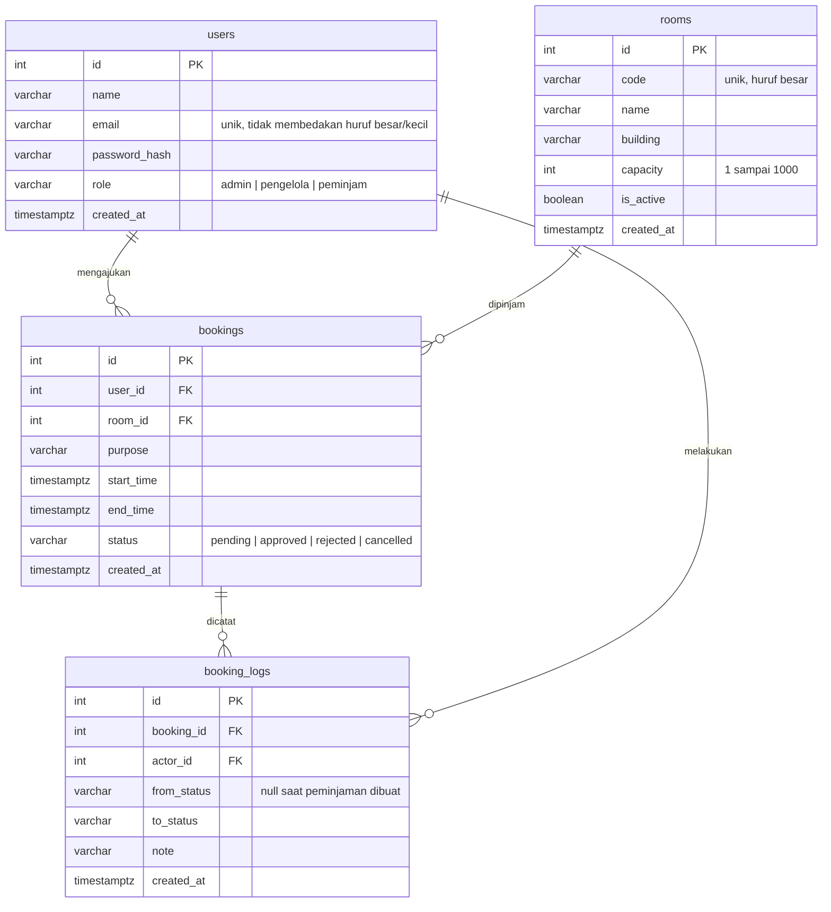

# RuangKu Backend

RuangKu adalah REST API untuk peminjaman ruangan kampus. Mahasiswa atau dosen mengajukan peminjaman ruang pada rentang waktu tertentu, lalu pengelola menyetujui atau menolaknya. Sistem menjamin dua peminjaman aktif tidak pernah bentrok pada ruang dan waktu yang sama.

Proyek ini dibuat untuk tugas kelompok mata kuliah Backend Lanjut dengan Go, Fiber, dan PostgreSQL.

## Peran

| Peran | Hak akses |
|---|---|
| `peminjam` | Mendaftar sendiri. Melihat ruang dan jadwal ketersediaan, mengajukan peminjaman, membatalkan peminjaman miliknya, melihat riwayat miliknya. |
| `pengelola` | Menyetujui atau menolak peminjaman, melihat semua peminjaman, melihat log status setiap peminjaman. |
| `admin` | Mengelola data ruang (tambah, ubah, nonaktifkan) dan mengubah peran pengguna. Akun admin pertama dibuat otomatis dari `.env`. |

## Fitur

- Registrasi dan login dengan JWT. Akun baru selalu berperan `peminjam`.
- Manajemen ruang oleh admin. Penghapusan bersifat soft delete (`is_active = false`).
- Cek ketersediaan ruang per tanggal.
- Pengajuan peminjaman dengan status `pending`, lalu `approved`, `rejected`, atau `cancelled`.
- Pencegahan bentrok jadwal di level database, sehingga aman terhadap request bersamaan.
- Log setiap perubahan status, ditulis dalam transaksi yang sama dengan perubahannya.
- Riwayat peminjaman milik sendiri dan daftar seluruh peminjaman dengan filter.
- Format response seragam untuk sukses dan error.

## Teknologi

| Komponen | Pilihan |
|---|---|
| Bahasa | Go 1.26 |
| Web framework | Fiber v2 |
| Database | PostgreSQL 16 (driver pgx v5) |
| Autentikasi | JWT HS256, password di-hash dengan bcrypt |
| Zona waktu | `Asia/Jakarta` (+07:00) |
| Infrastruktur lokal | Docker Compose |

## Struktur Proyek

Arsitekturnya Clean Architecture tanpa controller/handler. Method service menerima `*fiber.Ctx` dan langsung menjadi endpoint.

```
main.go            wiring dependency dan menjalankan server
route/             daftar route dan middleware per route
middleware/        RequireAuth, RequireRole
helper/            response, error, validator, JWT, password
config/            baca environment, konfigurasi Fiber
database/          koneksi PostgreSQL
migrations/        skema database (001_init.sql)
app/model/         struct request, response, dan entitas
app/repository/    akses database (SQL)
app/service/       aturan bisnis dan endpoint
http/              berkas uji REST Client
```

## Desain Database

Skema lengkap ada di `migrations/001_init.sql`. Docker menjalankannya otomatis saat volume database masih kosong.



Aturan penting di level database:

- `bookings` memakai constraint `EXCLUDE USING gist` pada `room_id` dan rentang waktu `[start_time, end_time)`. Hanya peminjaman `pending` dan `approved` yang memblokir ruang. Peminjaman 10.00-12.00 dan 12.00-14.00 tidak bentrok.
- `start_time` harus lebih kecil dari `end_time`.
- Foreign key `bookings` memakai `ON DELETE RESTRICT`. Log ikut terhapus bila peminjamannya dihapus (`ON DELETE CASCADE`).

### Status peminjaman

| Perubahan | Dilakukan oleh |
|---|---|
| `pending` ke `approved` | pengelola |
| `pending` ke `rejected` | pengelola |
| `pending` ke `cancelled` | peminjam pemilik |
| `approved` ke `cancelled` | peminjam pemilik |

Perubahan lain ditolak dengan 409.
